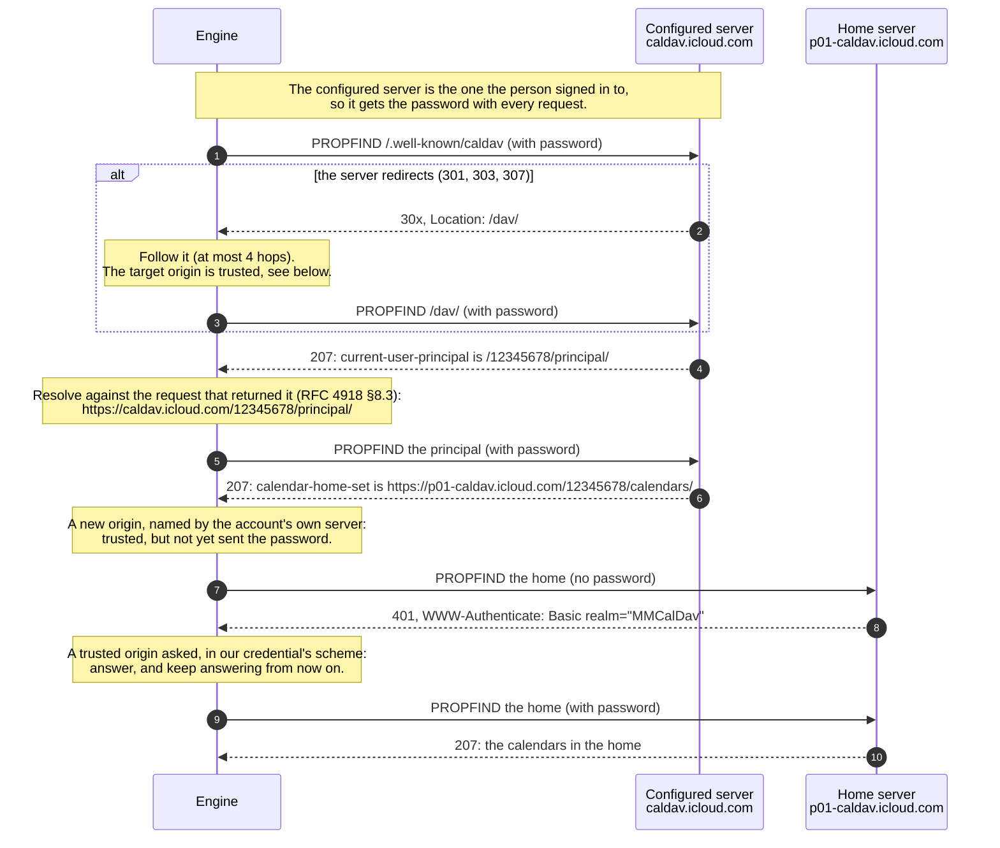
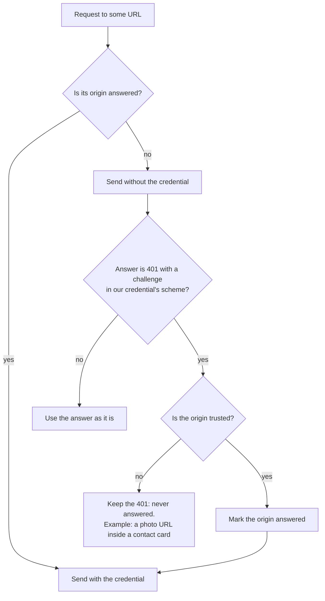
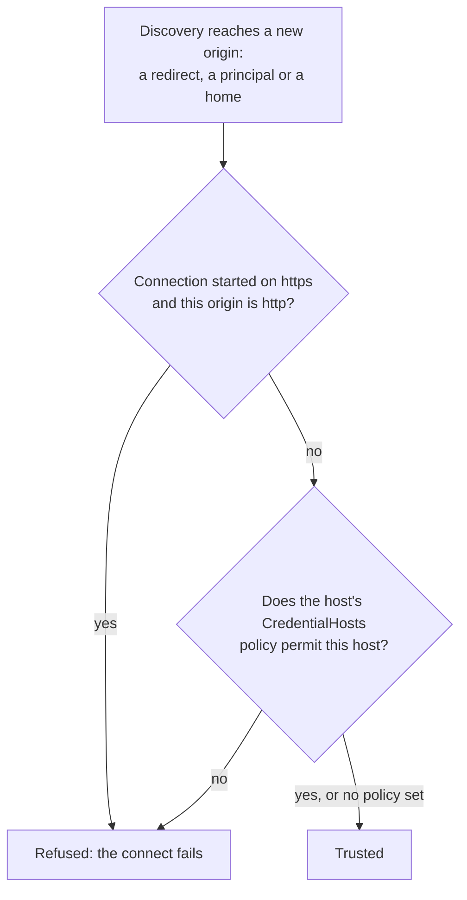

# provider-caldav: finding and talking to a CalDAV or CardDAV server

This crate is the engine's CalDAV (calendars, [RFC 4791]) and CardDAV (contacts, [RFC 6352])
adapter. Both protocols are WebDAV ([RFC 4918]) underneath, so they share one transport and
one way of finding the account's data. This page explains that part in plain terms: how a
connect gets from "the server's address and a password" to "here are your calendars", and
which hosts are ever given the password on the way.

`docs/agent-guidance/caldav.md` holds the protocol rules this crate follows in detail; this
page is the picture.

## Five words

| Word | What it is | iCloud example |
|---|---|---|
| **Origin** | Scheme, host and port: the unit HTTP scopes trust to ([RFC 6454], [RFC 9110] §4.3.1). `https://a.example` and `https://b.example` are two origins even when one company runs both. | `https://caldav.icloud.com` |
| **Principal** | The resource that stands for *you* on the server: "who am I". The server names it in `current-user-principal` ([RFC 5397]). | `/12345678/principal/` on `caldav.icloud.com` |
| **Home** | The folder your calendars (or address books) live in: "where is my stuff". A property of the principal: `calendar-home-set` ([RFC 4791] §6.2.1) or `addressbook-home-set` ([RFC 6352] §7.1.1). It may be on another origin. | `https://p01-caldav.icloud.com/12345678/calendars/` |
| **Collection** | One calendar or one address book: a folder inside the home. | `…/calendars/work/` |
| **Resource** | One event (`.ics`) or one contact card (`.vcf`) inside a collection. | `…/calendars/work/event.ics` |

## The walk

A connect starts at the URL the host configured (usually found through an SRV record and the
`/.well-known/caldav` path, [RFC 6764]) and asks three questions in turn.

1. **Where do I start?** The configured URL. A server must redirect its well-known path to the
   real one, and a client must follow ([RFC 6764] §5). Fastmail redirects to `/dav/calendars`
   on the same host; iCloud answers the well-known path directly.
2. **Who am I?** The `current-user-principal` ([RFC 5397]). Some servers put the home
   straight on the first answer, which skips the second question.
3. **Where is my stuff?** The principal's home-set. It is a full URL, and nothing requires
   it to be on the same host: iCloud puts it on a `pNN` host that differs per account.

Every href a step reads is resolved against the URL of **the request that returned it**
([RFC 4918] §8.3). That is why the principal above stays on `caldav.icloud.com` although the
home is elsewhere, and why a `Location` header is resolved against the URL that sent it
([RFC 9110] §10.2.2), not against the configured server.

When the walk is done the connection **settles on the home's origin**: every collection and
resource href the home returns is relative to it, so that is where later relative hrefs
resolve.

## Who gets the password

HTTP scopes a credential to a **protection space**, an origin plus the realm its challenge
names, and "a single protection space cannot extend outside the scope of its server"
([RFC 9110] §11.5). A redirect does not carry the credential along either: `Authorization`
is one of the fields a client removes and recomputes for the new request ([RFC 9110] §15.4).
The transport follows that literally, with two sets of origins per connection:

- **Trusted**: origins the account's own server led discovery to (the configured server, a
  redirect target, the principal, the home), each checked when it was added. Only these may
  ever receive the password.
- **Answered**: trusted origins that get the password with every request. The configured
  server starts here. Any other trusted origin joins only after it asks, with a `401` whose
  `WWW-Authenticate` offers the scheme our credential is for (`Basic` for a password, `Bearer`
  for a token).

How an origin becomes trusted:

A refusal fails the whole connect rather than carrying on without the credential: a request
that went out unauthenticated would come back `401`, and reading that as the server's answer
about the account would be wrong.

### A password and a token are confined differently

| | Password (`Credentials::Basic`) | OAuth token (`Credentials::Bearer`) |
|---|---|---|
| Who it is good for | One account on one service | Whoever its issuer's resource servers accept it at |
| What confines it | The trusted and answered sets above | The same, plus the host's `CredentialHosts` policy |
| Typical policy | None: the account's own server decides where its data is | The token issuer's hosts, so a token is never handed to a server outside them |
| Challenge it answers | `WWW-Authenticate: Basic` | `WWW-Authenticate: Bearer` |

`CredentialHosts` is the host application's say over which hosts may receive the credential
(`CalDavConfig::with_credential_hosts`, the same on `CardDavConfig`). It is consulted for the
configured URL before anything is sent, and for every origin discovery reaches. The adapter
cannot know a token's audience; the host can, from the issuer that granted it.

## Security measures

| Measure | Why | Where |
|---|---|---|
| **Verified TLS only.** The host supplies the trust policy; the engine builds no trust store of its own and never turns verification off. | A server's identity is its certificate ([RFC 6125]); DNS answers are not authenticated ([RFC 6764] §8). | `engine_tls`, `docs/agent-guidance/tls.md` |
| **No step down to plaintext.** A connection that started on `https` never trusts an `http` origin. | The password would cross the network in the clear, to a host nobody typed. | `DavClient::trust_origin` |
| **The credential is scoped per origin** and sent to a new origin only when it asks. | [RFC 9110] §11.5 and §15.4, as above. A host that never asks never receives it. | `credential_scope.rs` |
| **A URL named by content never gets the credential**, however it asks. | A contact card can name any host in `PHOTO;VALUE=uri`; that is data, not the server directing us. | `credential_scope.rs` |
| **The host may confine the credential to hosts it permits.** | A token is good wherever its issuer's resource servers accept it. | `credential_hosts.rs` |
| **Hrefs resolve against the request that returned them**, a `Location` against the URL that sent it. | Resolving against the wrong origin sends a request somewhere real that answers plausibly and is the wrong host ([RFC 4918] §8.3, [RFC 9110] §10.2.2). | `href.rs` |
| **At most four redirects** per discovery step. | A loop or a long chain is not a server directing us anywhere useful. | `discovery.rs` |
| **No secrets in logs.** `Credentials` redacts itself, and a redirect target's userinfo is scrubbed before a connect step reports it. | Connect steps are built to be logged. | `transport.rs`, `discovery.rs` |

## What a host should store

[RFC 6764] §6 asks a client to cache what worked ("principal-URL with full scheme/host/port
details") and to repeat the bootstrap when a later connection fails, "to refresh the cached
data". This adapter walks discovery on every connect, from the configured URL, so a host
needs to store only that URL and the credential. A `pNN` home host never needs storing: the
principal names it afresh on each connect, so a server that moves an account to another host
is followed without anyone noticing. When the configured server itself stops answering, the
host should repeat the SRV and well-known lookup.

## References

| RFC | What this crate takes from it |
|---|---|
| [RFC 4918] WebDAV | `PROPFIND`, multistatus, §8.3 relative href resolution |
| [RFC 4791] CalDAV | `calendar-home-set`, calendar reports |
| [RFC 6352] CardDAV | `addressbook-home-set`, address-book reports |
| [RFC 5397] | `current-user-principal` |
| [RFC 6764] | SRV records, `/.well-known/caldav` and `carddav`, the bootstrap, caching and refresh |
| [RFC 9110] HTTP | Redirects (§15.4), `Location` resolution (§10.2.2), protection spaces (§11.5), challenges (§11.6.1) |
| [RFC 6454] | What an origin is |
| [RFC 6125] | Certificate verification |
| [RFC 6578] | `sync-collection`, how collections are kept up to date |

[RFC 4791]: https://www.rfc-editor.org/rfc/rfc4791
[RFC 4918]: https://www.rfc-editor.org/rfc/rfc4918
[RFC 5397]: https://www.rfc-editor.org/rfc/rfc5397
[RFC 6125]: https://www.rfc-editor.org/rfc/rfc6125
[RFC 6352]: https://www.rfc-editor.org/rfc/rfc6352
[RFC 6454]: https://www.rfc-editor.org/rfc/rfc6454
[RFC 6578]: https://www.rfc-editor.org/rfc/rfc6578
[RFC 6764]: https://www.rfc-editor.org/rfc/rfc6764
[RFC 9110]: https://www.rfc-editor.org/rfc/rfc9110
