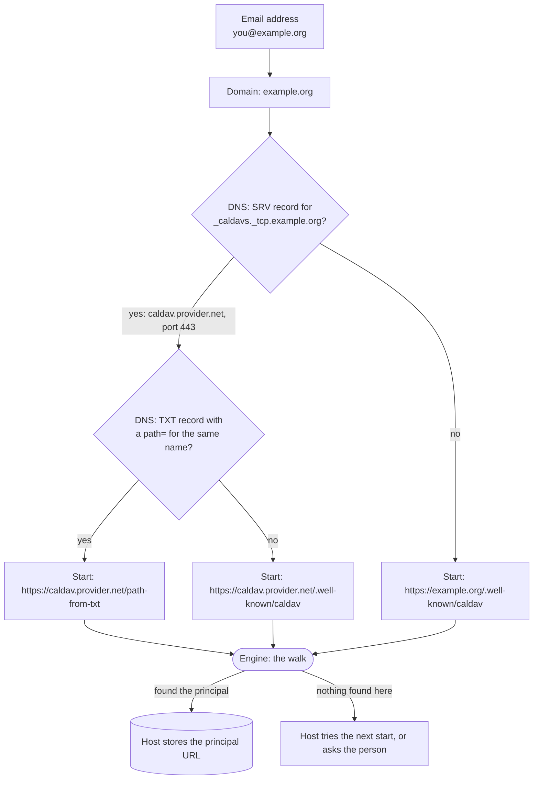
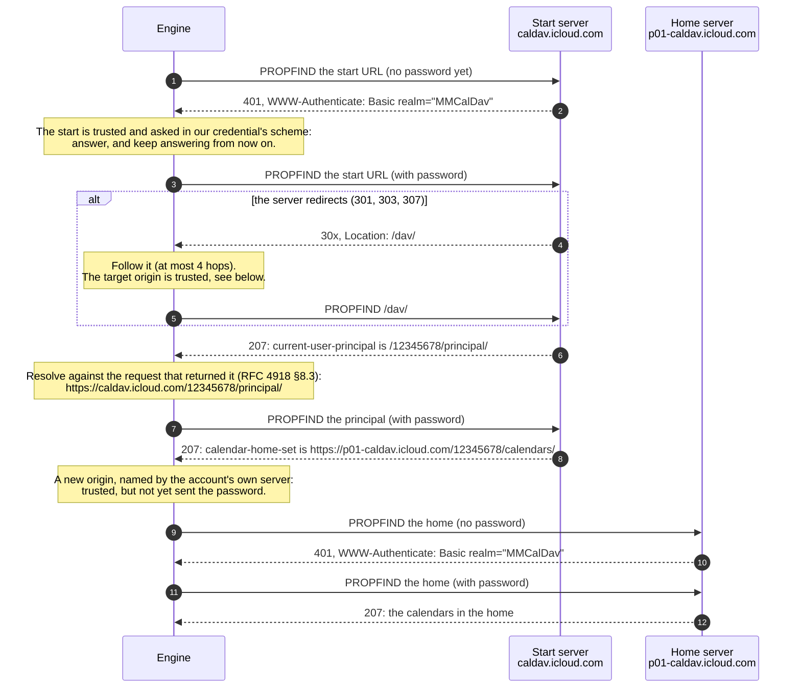
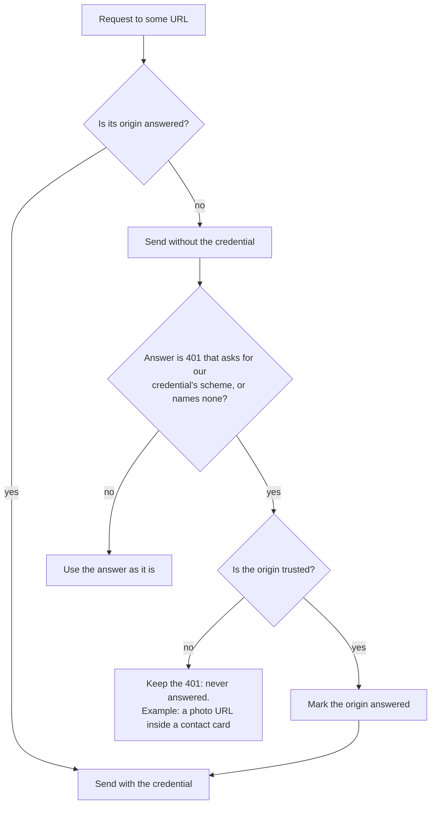
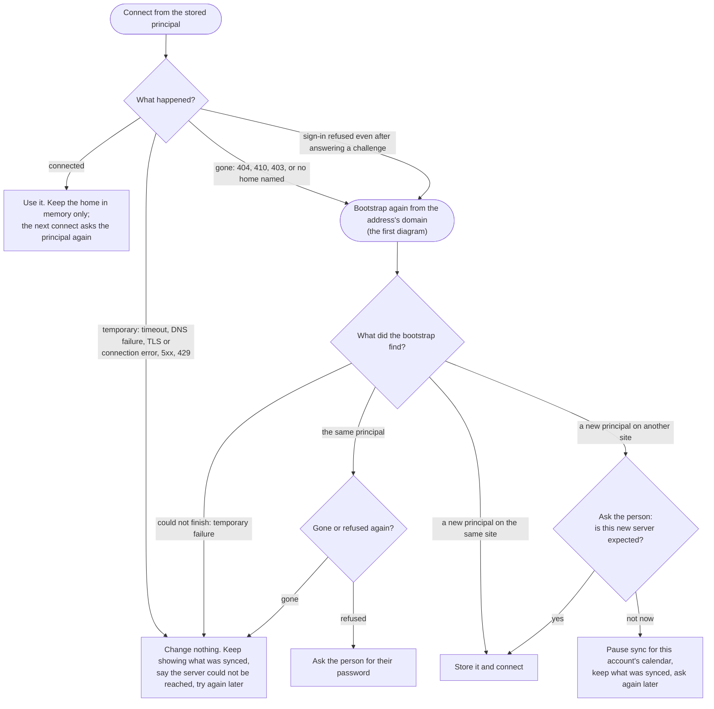

# provider-caldav: finding and talking to a CalDAV or CardDAV server

This crate is the engine's CalDAV (calendars, [RFC 4791]) and CardDAV (contacts, [RFC 6352])
adapter. Both protocols are WebDAV ([RFC 4918]) underneath, so they share one transport and
one way of finding the account's data. This page explains that part in plain terms: how a
connect gets from "an email address and a password" to "here are your calendars", which
hosts are ever given the password on the way, and what happens when a server moves or goes
quiet.

The work is split in two. The **host** application finds where to start and remembers what
worked; this **engine** walks from that starting point to the account's data. The diagrams
mark which side does what.

`docs/agent-guidance/caldav.md` holds the protocol rules this crate follows in detail; this
page is the picture.

## Five words

| Word | What it is | iCloud example |
|---|---|---|
| **Origin** | Scheme, host and port: the unit HTTP scopes trust to ([RFC 6454], [RFC 9110] §4.3.1). `https://a.example` and `https://b.example` are two origins even when one company runs both. | `https://caldav.icloud.com` |
| **Principal** | The resource that stands for *you* on the server: "who am I". The server names it in `current-user-principal` ([RFC 5397]). This is what a host stores. | `https://caldav.icloud.com/12345678/principal/` |
| **Home** | The folder your calendars (or address books) live in: "where is my stuff". A property of the principal: `calendar-home-set` ([RFC 4791] §6.2.1) or `addressbook-home-set` ([RFC 6352] §7.1.1). It may be on another origin. | `https://p01-caldav.icloud.com/12345678/calendars/` |
| **Collection** | One calendar or one address book: a folder inside the home. | `…/calendars/work/` |
| **Resource** | One event (`.ics`) or one contact card (`.vcf`) inside a collection. | `…/calendars/work/event.ics` |

Two more terms appear in the first diagram. An **SRV record** is a DNS entry in which a domain
says which server runs a service for it ([RFC 2782]); `_caldavs._tcp.example.org` names the
calendar server for addresses at `example.org`. A **well-known URL** is a fixed path every
server reserves for a service ([RFC 8615]); `/.well-known/caldav` leads to the calendar
service.

## Finding where to start (host, first time)

Nobody types a server address any more. From the email address alone, a host finds a starting
URL the way [RFC 6764] §6 describes, then hands it to the engine.

- Only the TLS service label (`_caldavs`, `_carddavs`) is looked up. The plaintext ones exist
  in the RFC, but nothing would be sent to such a server.
- A TXT path that fails sends the host back to the well-known URL ([RFC 6764] §6 step 3), so a
  host that cannot read TXT records loses nothing but a shortcut.
- DNS answers are not authenticated, which is why verified TLS matters from the first request
  on ([RFC 6764] §8).
- CardDAV is the same with `_carddavs` and `/.well-known/carddav`.

## The walk (engine)

From the start URL, or from a principal stored by an earlier connect, the engine asks three
questions in turn. Nobody gets the password before they ask for it, including the first server.

1. **Where do I start?** The start URL. A server must redirect its well-known path to the real
   one, and a client must follow ([RFC 6764] §5). Fastmail redirects to `/dav/calendars` on the
   same host; iCloud answers the well-known path directly.
2. **Who am I?** The `current-user-principal` ([RFC 5397]). When the walk starts at a stored
   principal, the first answer names it again along with the home.
3. **Where is my stuff?** The principal's home-set. It is a full URL, and nothing requires it
   to be on the same host: iCloud puts it on a `pNN` host that differs per account.

Every href a step reads is resolved against the URL of **the request that returned it**
([RFC 4918] §8.3). That is why the principal stays on `caldav.icloud.com` although the home is
elsewhere, and why a `Location` header is resolved against the URL that sent it
([RFC 9110] §10.2.2).

When the walk is done the connection **settles on the home's origin**: every collection and
resource href the home returns is relative to it. The provider reports the principal it found
(`CalDavProvider::principal_url`, `CardDavProvider::principal_url`) for the host to store.

## Who gets the password (engine)

HTTP scopes a credential to a **protection space**, an origin plus the realm its challenge
names, and "a single protection space cannot extend outside the scope of its server"
([RFC 9110] §11.5). A redirect does not carry the credential along either: `Authorization`
is one of the fields a client removes and recomputes for the new request ([RFC 9110] §15.4).
The transport follows that literally, with two sets of origins per connection:

- **Trusted**: the start URL's origin, and every origin the account's own server led discovery
  to from there (a redirect target, the principal, the home), each checked when it was added.
  Only these may ever receive the password.
- **Answered**: trusted origins that get the password with every request. None starts here.
  A trusted origin joins once it asks, with a `401` whose `WWW-Authenticate` offers the scheme
  our credential is for (`Basic` for a password, `Bearer` for a token), and stays for as long
  as the connection lasts: the reuse RFC 9110 §11.5 allows "if a prior request has been
  authorized". A `401` with no challenge at all counts as asking too: RFC 9110 §15.5.2 says
  a `401` MUST carry one, but Yahoo's calendar server sends none. A `401` whose challenges all
  name another scheme is not answered, since that server has said what it wants.

How an origin becomes trusted:

A refusal fails the whole connect rather than carrying on without the credential: a request
that went out unauthenticated would come back `401`, and reading that as the server's answer
about the account would be wrong.

Answering a challenge is not a defence against a hostile server: a host that has taken over a
domain will simply ask. What keeps the password away from one is never connecting to a host
that may have gone stale, which is why a host stores the principal and nothing found after it
(below).

### A password and a token are confined differently

| | Password (`Credentials::Basic`) | OAuth token (`Credentials::Bearer`) |
|---|---|---|
| Who it is good for | One account on one service | Whoever its issuer's resource servers accept it at |
| What confines it | The trusted and answered sets above | The same, plus the host's `CredentialHosts` policy |
| Typical policy | None: the account's own server decides where its data is | The token issuer's hosts, so a token is never handed to a server outside them |
| Challenge it answers | `WWW-Authenticate: Basic` | `WWW-Authenticate: Bearer` |

`CredentialHosts` is the host application's say over which hosts may receive the credential
(`CalDavConfig::with_credential_hosts`, the same on `CardDavConfig`). It is consulted for the
configured URL before anything is sent, and for every origin discovery reaches. The adapter
cannot know a token's audience; the host can, from the issuer that granted it.

## When something goes wrong (host, with the engine's verdict)

Every failed connect carries a `FailureClass` (`CalDavError::failure_class`), and the class,
not the message, decides what happens next. Only a principal that is **gone** sends the host
back to the first diagram; a server that is merely **unreachable** changes nothing, so a
network blip never ends in a setup screen.

| What failed | `FailureClass` | What the host does |
|---|---|---|
| Timeout, DNS failure, refused or reset connection, TLS handshake failure | `Retryable` | Nothing changes. Retry later. |
| `5xx`, `423 Locked` | `Retryable` | Nothing changes. Retry later. |
| `429 Too Many Requests` | `RateLimited` | Nothing changes. Retry after the server's `Retry-After`. |
| `404`, `410`, `403`, or a principal that names no home | `Permanent` | Bootstrap again ([RFC 6764] §6: "If a subsequent connection attempt fails … SHOULD retry the SRV lookup and account discovery"). |
| `401` after the challenge was answered | `Authentication` | Bootstrap again once ("or authentication fails persistently"); if the same server still refuses, ask for the password. |

A captive portal or a hotel network cannot pass for the account's server, because it cannot
present the server's TLS certificate: what reaches the host is a `Retryable` TLS failure, not a
`404` that would trigger a bootstrap.

Why a new principal on **another site** is asked about: a site is a registrable domain
(`icloud.com`, `fastmail.com`), the unit an organisation controls. A move within one
(`caldav.icloud.com` to `caldav2.icloud.com`) is the provider reorganising itself. A move to a
different one, after DNS changed, is exactly what a hijacked domain or a tampered DNS answer
looks like, and [RFC 6764] §8 asks a client to "verify with the user" when a server falls
outside the domain it expected.

## What a host should store

[RFC 6764] §6 asks a client to cache "the service details that were successfully used (user
identity, principal-URL with full scheme/host/port details)" and to refresh them when a later
connection fails. CardDAV says the same: "the key piece of information that they require is the
principal-URL" ([RFC 6352] §9.3).

| Store | Why |
|---|---|
| The principal URL (`principal_url()`) | The start of every connect. Stable, and named by the account's own server. |
| The credential, in the platform's secure store | Sent only where the rules above allow. |
| The email address or domain | The root of a fresh bootstrap when the principal is gone. |

| Do not store | Why |
|---|---|
| The home, or a `pNN` host | The principal names it afresh on each connect. Stored, it is a host that may go stale, change hands, and still be dialled with the password. A host may keep it in memory between connects. |
| The end of a redirect chain | The server decides whether a redirect may be cached ([RFC 6764] §5); the principal it leads to is what lasts. |

## References

| RFC | What this crate takes from it |
|---|---|
| [RFC 4918] WebDAV | `PROPFIND`, multistatus, §8.3 relative href resolution |
| [RFC 4791] CalDAV | `calendar-home-set`, calendar reports |
| [RFC 6352] CardDAV | `addressbook-home-set`, address-book reports, §9.3 client configuration |
| [RFC 5397] | `current-user-principal` |
| [RFC 6764] | SRV and TXT records, `/.well-known/caldav` and `carddav`, the bootstrap, caching and refresh, §8 verifying a server outside the domain |
| [RFC 2782] | SRV records |
| [RFC 8615] | Well-known URLs |
| [RFC 9110] HTTP | Redirects (§15.4), `Location` resolution (§10.2.2), protection spaces (§11.5), challenges (§11.6.1) |
| [RFC 6454] | What an origin is |
| [RFC 6125] | Certificate verification |
| [RFC 6578] | `sync-collection`, how collections are kept up to date |

[RFC 2782]: https://www.rfc-editor.org/rfc/rfc2782
[RFC 4791]: https://www.rfc-editor.org/rfc/rfc4791
[RFC 4918]: https://www.rfc-editor.org/rfc/rfc4918
[RFC 5397]: https://www.rfc-editor.org/rfc/rfc5397
[RFC 6125]: https://www.rfc-editor.org/rfc/rfc6125
[RFC 6352]: https://www.rfc-editor.org/rfc/rfc6352
[RFC 6454]: https://www.rfc-editor.org/rfc/rfc6454
[RFC 6578]: https://www.rfc-editor.org/rfc/rfc6578
[RFC 6764]: https://www.rfc-editor.org/rfc/rfc6764
[RFC 8615]: https://www.rfc-editor.org/rfc/rfc8615
[RFC 9110]: https://www.rfc-editor.org/rfc/rfc9110
